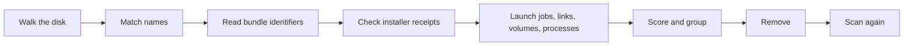

# Uproot

**Find everything an app, game, or plug-in left on your Mac — and remove it in one go.**

[English](README.md) · [Русский](README.ru.md) · [Español](README.es.md) · [Українська](README.uk.md)


Uproot is a native macOS app for a job Finder does not do. When you drag an application to the Trash, its preferences, caches, containers, launch agents, audio plug-ins, installer receipts, and vendor folders stay behind. Uproot finds all of it, groups what it finds, explains why each item is there, and removes what you check.

It replaces the manual loop of `mdfind` → `find` → `grep -v` → `sudo rm -rf` → `pkgutil --forget` → checking again.

> The interface is currently in Russian. The search itself is language-agnostic: it matches names, bundle identifiers, and paths as they are on disk.

## Why it exists

Uninstalling a Mac app is rarely one drag. A plug-in may leave a VST3 and an Audio Unit, a shared content folder, presets in your home folder, a cache, a preferences file, several installer receipts, a launch agent, and a mounted installer image. Some of it is named after the product, some only after the vendor, and some only after a bundle identifier such as `com.vendor.product`.

Doing this by hand means several searches, reading paths, deciding which `terrain` folder belongs to the plug-in and which belongs to a game, and remembering to forget the receipts. Uproot does that pass for you and keeps the decision in your hands.

## Features

- **Two search modes.** Look for a program and everything it left behind, or search any files and folders by name.
- **More than file names.** Uproot follows bundle identifiers, installer receipts, launch agents and daemons, command-line symlinks, running processes, mounted installer images, Windows programs in CrossOver/Wine bottles, and the FL Studio plug-in database.
- **Vendor search.** Add the developer or publisher and Uproot also finds folders named after the company and what is inside them.
- **Conservative preselection.** Only items Uproot is confident about are checked. Everything doubtful stays unchecked and is explained.
- **One password prompt.** Whatever needs administrator rights is collected into a single script and run once.
- **Trash by default.** Items go to the Trash, or can be deleted permanently if you choose.
- **Verification after removal.** Uproot scans again and tells you what is still there.
- **Removal journal.** Every operation is recorded, and trashed items can be put back from the journal — except those moved with administrator rights, which have to be restored from the Trash by hand.
- **No network access.** The app does not connect anywhere; everything happens on your Mac.

## Requirements

- macOS 14 Sonoma or later, on Apple Silicon or Intel.
- **Full Disk Access** for Uproot. Without it the scan still works, but some folders stay unreadable, macOS asks for access to Documents, Downloads, and other folders one by one, and removing other apps' files from `/Applications` may be refused.
- To build from source: Xcode 26 or newer and Swift 6.

## Install

1. Download the latest `.dmg` from the [Releases](../../releases) page.
2. Open the image and drag **Uproot** onto the **Applications** folder.
3. The app is not notarized by Apple, so the first launch has to be approved by hand:
   - **macOS 15 or later:** open Uproot from Applications, click **Done** in the warning, then go to **System Settings → Privacy & Security**, scroll down to the Uproot line, and click **Open Anyway**.
   - **macOS 14:** right-click Uproot in Applications → **Open** → **Open**.
4. Grant **Full Disk Access**: **System Settings → Privacy & Security → Full Disk Access**, enable Uproot, then relaunch it. The app has buttons for both steps in its window.

You only need to do this once. If you build the app yourself, see [Building from source](#building-from-source).

## Quick start

1. Type the name of an application, game, or plug-in. For several names, separate them with commas.
2. Optionally add the company that makes it.
3. Press **Enter**.
4. Review the list. Checked items are the ones Uproot is sure about; uncheck anything you want to keep.
5. Click **Delete…** («Удалить…»), choose **Move to Trash** («В Корзину») or **Delete permanently** («Удалить навсегда»), and confirm.
6. Uproot removes the selection, scans again, and shows what is left.

## Two search modes

### A program and its traces

The main mode. Enter a product name and, optionally, a vendor. Besides names on disk, Uproot checks:

- **bundle identifiers** of the programs it found (`com.vendor.app`) — this finds preferences, caches, and containers whose names do not contain the product name;
- **installer receipts** (`pkgutil`) and the files those packages installed;
- **launch agents and daemons** that start the found programs;
- **symlinks** in `/usr/local/bin`, `/opt/homebrew/bin`, `~/bin`, and `~/.local/bin`;
- **running processes** started from the found files;
- **mounted installer images** left after an install;
- **Windows programs** inside CrossOver and Wine bottles;
- **the FL Studio plug-in database**.

### Files and folders

A plain search by name or part of a name. Every match is shown, including personal documents, and nothing is preselected.

### Options

Under **Options** («Параметры») you can:

- exclude paths containing certain words;
- search inside other apps' and plug-ins' bundles (`.app`, `.vst3`, and similar) — slower, and most matches will turn out to be parts of other programs;
- scan external volumes, not just the startup disk.

## How to read the results

| In the list | Meaning |
| --- | --- |
| Checkbox is on | Uproot is confident: the name matches and the item sits where software is installed |
| «проверьте» (check) tag, checkbox off | Probably related, but your call: downloads, another vendor's folder, a similar name |
| «Сомнительные совпадения» (Doubtful matches) section | The name is similar, but the item is most likely part of another program or one of your documents |
| Red «внутри ещё N объектов» (N more objects inside) tag | The folder contains more than what was found; checking it removes everything inside |
| Lock | Removing this item will require an administrator password |

The list can be grouped by type or by folder, filtered by text, and collapsed by section.

- **Space** checks or unchecks the selected rows.
- **Double-click** shows the item in Finder.
- **Right-click** offers Quick Look, copying the path, and **Remove from results**. Removing an item from the results does not delete it, and it also excludes it from a parent folder's selection; the rest of that folder stays checked.

## What Uproot never touches

Some things are never offered, however the search is spelled:

- the standard folders macOS is built on — `~/Library/Preferences`, `/Library/Audio/Plug-Ins/VST3`, `~/Documents`, and the like. A search for “Audio” looks inside such a folder but does not propose the folder itself;
- folders where built-in apps keep your data — `~/Library/Mail`, `~/Library/Messages`, `~/Library/Safari`, `~/Library/Calendars`, `~/Library/Accounts`, and others;
- items marked by macOS itself as not removable, and paths the app considers system-protected. Even if one gets into the list through a file search, removal is refused.

Objects whose names belong to macOS or Apple (`com.apple.Notes`, for example) are shown with the «проверьте» tag and without a checkbox — unless the Apple program itself is what you are removing, such as Xcode.

## How it works



1. **Walk.** A parallel walker reads the home folder, `/Applications`, `/Library`, `/Users/Shared`, `/usr/local`, `/opt`, parts of `/private/etc` and `/private/var`, and the user's temporary and cache folders. It skips `.git`, `node_modules`, Trash, Spotlight indexes, and the data folders of built-in apps. It does not enter other volumes unless asked, and it does not download iCloud placeholders just to read their names.
2. **Match names.** Names are folded to lowercase letters and digits, with separators and accents removed and word boundaries recorded. `Safe_Exam Browser-3.7.dmg` becomes `safeexambrowser37dmg`, so one term finds every spelling of a product name. Short terms (up to four characters) match whole words only, so “SEB” does not find “Sebastian”.
3. **Follow identifiers.** Uproot reads the `Info.plist` of the programs it found and looks up their bundle identifiers in `Preferences`, `Caches`, `Containers`, `Application Support`, `Saved Application State`, `LaunchAgents`, and similar folders.
4. **Check receipts.** Installer receipts that match the product are listed, and files installed by those packages are added even when their own names say nothing.
5. **Add what hangs off the found items.** Launch jobs, command-line links, mounted images, processes, CrossOver/Wine programs, and FL Studio database entries.
6. **Score and group.** A verdict depends on two things: how well the name matches, and where the item sits. A strong match in an install location is trusted. The same match deep inside another program's files is shown but left unchecked. Nothing among your personal documents is ever preselected.
7. **Remove.** Everything the current user may do is done directly. The rest is collected into one shell script and run with administrator rights, so there is a single password prompt. Processes are stopped first, then volumes are ejected, files are trashed or deleted, and receipts are forgotten. Launch daemons are unloaded with `launchctl bootout`; after an Audio Unit is removed, `AudioComponentRegistrar` is restarted.
8. **Verify.** Uproot scans again and reports what remains. If something reappears, the program or plug-in is probably still running — for example, loaded in a DAW. Close it and repeat.

The matching rules live in [`RelevanceScorer.swift`](Packages/UprootCore/Sources/UprootCore/Classify/RelevanceScorer.swift), and the standard macOS folder layout is described in [`Placement.swift`](Packages/UprootCore/Sources/UprootCore/Classify/Placement.swift).

## Try it without risk

`Tools/make-fixture.sh` builds a small fake Mac in a folder, reproducing the clean-up scenarios this app was written for. In this mode Uproot never leaves the folder and never touches real system records.

```sh
Tools/make-fixture.sh /tmp/uproot-playground
open /Applications/Uproot.app --args --fixture /tmp/uproot-playground \
    --name Terrain --name "Terrain FX" --vendor "Waves Crate" --scan
```

The folder must be given as a full path and must contain `Users/tester`. With an empty value, `/`, or a typo in the path, the app refuses to start rather than silently working on the real disk.

## Command line

`uproot-scan` is a read-only front end to the scanner. It never deletes anything.

```sh
cd Packages/UprootCore
swift run -c release uproot-scan Terrain "Terrain FX" --vendor "Waves Crate"
swift run -c release uproot-scan --files invoice
```

```text
usage: uproot-scan <name>... [--vendor <company>]... [--exclude <text>]...
                   [--files] [--inside-bundles] [--external] [--all]
```

The app itself also accepts launch arguments:

| Argument | Effect |
| --- | --- |
| `--name <text>` | A program or file name; may be repeated |
| `--vendor <text>` | A company name; may be repeated |
| `--files` | Search for files by name instead of for a program |
| `--scan` | Start searching at once |
| `--fixture <path>` | Treat `<path>` as the disk root and `<path>/Users/tester` as the home folder |
| `--show <what>` | Open `confirm`, `history`, `options`, or `doubtful` once ready |
| `--filter <text>` | Start with the result list filtered |
| `--window <WxH>` | Open the window at this size, in points |
| `--remove` | With `--fixture` only: remove what the scan preselects, without asking |

## Building from source

You need Xcode 26 or newer.

```sh
Tools/build.sh             # build dist/Uproot.app, sign with a developer certificate if one exists
Tools/build.sh --adhoc     # local ad-hoc signature only
cd Packages/UprootCore && swift test
```

To hand the app to another Mac, build a disk image:

```sh
Tools/make-dmg.sh          # dist/Uproot-<version>.dmg: the app, an Applications shortcut, and install notes
```

The app is built with **Hardened Runtime**, and `Tools/build.sh` checks that the finished build has it. Without it, any program could load its own code into Uproot and borrow its Full Disk Access.

macOS ties Full Disk Access to the code signature. With a certificate the permission survives rebuilds; with an ad-hoc signature you have to enable it again after every build. The first time you sign with a certificate, the keychain will ask for a password — choose **Always Allow**.

## Project layout

```text
Packages/UprootCore/        logic without the interface, covered by tests
  Matching/                 name folding and comparison with the query
  Scan/                     parallel disk walk, hit collection, scoring
  Classify/                 where things live on macOS and how much to trust a match
  Sources/                  installer packages, launchd, processes, volumes, Info.plist
  Removal/                  removal and the administrator script
  Model/, History/          result model with checkboxes, journal
Uproot/                     the SwiftUI app
  App/                      window state, launch, administrator rights
  Views/                    screens
Tools/                      build, disk image, icon, test disk
```

## Known limitations

- Running the administrator script as root after the password prompt has not been verified on a live system. The prompt itself works, and the script is covered by tests without elevation.
- Items trashed with administrator rights can only be restored manually from the Trash.
- Login items added through **System Settings → General → Login Items** are not shown: macOS does not expose them without root.
- Short names (up to four letters) are matched as whole words only, so “SEB” does not find “Sebastian”. Digits and hyphens inside such a name are treated as part of it: “Pro-Q” finds “FabFilter Pro-Q 3”, and “C1” finds “C1 comp”.
- A generic word instead of a name (“Helper”, “Agent”, “Preferences”) will match files from many programs, and some of them will be checked. Read the list before removing, and add the vendor to the search.
- The administrator prompt from a Hardened Runtime build has not been verified on a live system. The mechanism (`do shell script` in a protected process) is tested without elevation.
- The interface is currently Russian-only.

## FAQ

**The app will not open.** This is expected: the build is not notarized. Approve it once in **System Settings → Privacy & Security → Open Anyway**.

**macOS keeps asking for access to folders.** Full Disk Access is not enabled, or the app has not been relaunched since you enabled it.

**Something came back after removal.** The program or plug-in is still running, often loaded into a DAW or a browser. Quit it and run the removal again.

**Do I need to pay for anything?** No. The app is free, open source, and released into the public domain.

**Does Uproot send any data anywhere?** No. It makes no network requests.

## License

Released into the public domain under the [Unlicense](LICENSE). You can use, copy, modify, and distribute this software for any purpose, with or without attribution.
