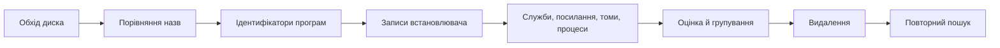

# Uproot

**Знаходить усе, що програма, гра або плагін залишили на Mac, — і видаляє це за один раз.**

[English](README.md) · [Русский](README.ru.md) · [Español](README.es.md) · [Українська](README.uk.md)


Uproot — нативний застосунок для macOS, який робить те, чого не вміє Finder. Коли ви перетягуєте програму до Кошика, її налаштування, кеш, контейнери, служби автозапуску, аудіоплагіни, записи встановлювача й папки розробника залишаються на диску. Uproot знаходить усе це, групує знайдене, пояснює, чому кожен об'єкт потрапив до списку, і видаляє те, що ви позначите.

Застосунок замінює ручний цикл `mdfind` → `find` → `grep -v` → `sudo rm -rf` → `pkgutil --forget` → повторна перевірка.

> Інтерфейс зараз російською мовою. Сам пошук від мови не залежить: він порівнює імена, ідентифікатори пакетів і шляхи такими, якими вони лежать на диску.

## Навіщо це потрібно

Видалити програму на Mac рідко вдається одним перетягуванням. Плагін може залишити VST3 та Audio Unit, спільну папку з контентом, пресети в домашній папці, кеш, файл налаштувань, кілька записів встановлювача, службу автозапуску й змонтований образ інсталятора. Частина цього названа за продуктом, частина — лише за компанією, а частина — лише за ідентифікатором на кшталт `com.vendor.product`.

Вручну це кілька пошуків, читання шляхів, рішення, яка папка `terrain` належить плагіну, а яка — грі, і потреба не забути видалити записи встановлювача. Uproot робить цей прохід за вас, залишаючи рішення за вами.

## Можливості

- **Два режими пошуку.** Шукати програму й усе, що вона залишила, або шукати будь-які файли й папки за назвою.
- **Не лише імена файлів.** Uproot іде за ідентифікаторами програм, записами встановлювача, службами автозапуску, посиланнями в командному рядку, запущеними процесами, змонтованими образами інсталяторів, програмами Windows у пляшках CrossOver/Wine і базою плагінів FL Studio.
- **Пошук за компанією.** Додайте розробника або видавця — Uproot знайде і папки з назвою компанії, і те, що лежить усередині.
- **Обережні позначки.** Заздалегідь позначається лише те, у чому застосунок упевнений. Усе сумнівне залишається без галочки й з поясненням.
- **Один запит пароля.** Усе, що потребує прав адміністратора, збирається в один сценарій і виконується за один раз.
- **Кошик за замовчуванням.** Об'єкти переміщуються до Кошика; за бажанням їх можна видалити назавжди.
- **Перевірка після видалення.** Uproot шукає ще раз і повідомляє, що залишилося.
- **Журнал видалень.** Кожна операція записується, а переміщене до Кошика без прав адміністратора можна повернути просто з журналу.
- **Немає доступу до мережі.** Застосунок нікуди не підключається; усе відбувається на вашому Mac.

## Вимоги

- macOS 14 Sonoma або новіша, на Apple Silicon чи Intel.
- **Повний доступ до диска** для Uproot. Без нього пошук працює, але частина папок залишиться непрочитаною, macOS запитуватиме доступ до «Документів», «Завантажень» та інших папок по одній, а видалення чужих файлів із `/Applications` може бути відхилене.
- Для збирання з вихідного коду: Xcode 26 або новіший і Swift 6.

## Встановлення

1. Завантажте останній `.dmg` зі сторінки [Releases](../../releases).
2. Відкрийте образ і перетягніть **Uproot** до папки **Програми**.
3. Застосунок не нотаризований Apple, тому перший запуск доведеться схвалити вручну:
   - **macOS 15 або новіша:** відкрийте Uproot із «Програм», у вікні попередження натисніть **Готово**, потім перейдіть до **Системних налаштувань → Конфіденційність і безпека**, прокрутіть до рядка про Uproot і натисніть **Все одно відкрити**.
   - **macOS 14:** клацніть Uproot у «Програмах» правою кнопкою → **Відкрити** → **Відкрити**.
4. Увімкніть **Повний доступ до диска**: **Системні налаштування → Конфіденційність і безпека → Повний доступ до диска**, увімкніть Uproot і перезапустіть його. У вікні застосунку є кнопки для обох кроків.

Це потрібно зробити один раз. Якщо ви збираєте застосунок самі, дивіться розділ про збирання нижче.

## Швидкий старт

1. Введіть назву програми, гри або плагіна. Кілька назв — через кому.
2. За бажанням додайте компанію-розробника.
3. Натисніть **Enter**.
4. Перегляньте список. Галочки стоять у того, у чому Uproot упевнений; зніміть їх із того, що хочете залишити.
5. Натисніть **Видалити…** («Удалить…»), виберіть **До Кошика** або **Видалити назавжди** й підтвердьте.
6. Uproot видалить позначене, виконає пошук заново й покаже, що залишилося.

## Два режими пошуку

### Програма та її сліди

Основний режим. Введіть назву продукту і, якщо потрібно, компанію. Крім імен на диску Uproot перевіряє:

- **ідентифікатори** знайдених програм (`com.vendor.app`) — так знаходяться налаштування, кеш і контейнери, у назвах яких немає назви програми;
- **записи встановлювача** (`pkgutil`) і файли, які ці пакети встановили;
- **служби автозапуску**, що запускають знайдене;
- **посилання** в `/usr/local/bin`, `/opt/homebrew/bin`, `~/bin` і `~/.local/bin`;
- **запущені процеси**, що стартували зі знайдених файлів;
- **змонтовані образи інсталяторів**, що залишилися після встановлення;
- **програми Windows** у пляшках CrossOver і Wine;
- **базу плагінів FL Studio**.

### Файли та папки

Звичайний пошук за назвою або її частиною. Показуються всі збіги, включно з особистими документами; нічого не позначається заздалегідь.

### Параметри

У розділі **Параметри** («Параметры») можна:

- виключити шляхи, що містять певні слова;
- шукати всередині чужих пакетів `.app`, `.vst3` і подібних — довше, і майже все знайдене виявиться частинами інших програм;
- переглядати зовнішні диски, а не лише системний.

## Що означають позначки

| У списку | Значення |
| --- | --- |
| Галочка стоїть | Uproot упевнений: назва збіглася й об'єкт лежить там, куди встановлюють програми |
| Позначка «проверьте» (перевірте), галочки немає | Імовірно стосується, але вирішувати вам: завантаження, папка іншого виробника, схожа назва |
| Розділ «Сомнительные совпадения» (сумнівні збіги) | Назва схожа, але це, найімовірніше, частина іншої програми або ваш документ |
| Червона позначка «внутри ещё N объектов» (усередині ще N об'єктів) | У папці є щось, крім знайденого; позначивши її, ви видалите весь вміст |
| Замок | Для видалення знадобиться пароль адміністратора |

Список групується за типом або за папками, фільтрується за текстом і згортається за розділами.

- **Пробіл** ставить і знімає галочку у виділених рядків.
- **Подвійний клік** показує об'єкт у Finder.
- **Контекстне меню** пропонує швидкий перегляд, копіювання шляху та **Прибрати з результатів**. Прибраний об'єкт не видаляється і не видаляється разом із батьківською папкою: з неї знімається галочка, позначеним залишається решта її вмісту.

## Чого Uproot не чіпає

Деякі речі не потрапляють до списку, хоч би як був написаний запит:

- стандартні папки macOS — `~/Library/Preferences`, `/Library/Audio/Plug-Ins/VST3`, `~/Documents` і подібні. Пошук за словом «Audio» заглядає до такої папки, але саму її не пропонує;
- папки, де вбудовані програми зберігають ваші дані, — `~/Library/Mail`, `~/Library/Messages`, `~/Library/Safari`, `~/Library/Calendars`, `~/Library/Accounts` та інші;
- об'єкти, які система сама позначила як невидалювані, і шляхи, які застосунок вважає системними. Навіть якщо такий об'єкт потрапив до списку через пошук файлів, видалення буде відхилене.

Об'єкти з назвами програм Apple (`com.apple.Notes`, наприклад) показуються з позначкою «проверьте» і без галочки — крім випадку, коли ви видаляєте саму програму Apple, наприклад Xcode.

## Як це працює



1. **Обхід.** Паралельний обхідник читає домашню папку, `/Applications`, `/Library`, `/Users/Shared`, `/usr/local`, `/opt`, частини `/private/etc` і `/private/var`, а також тимчасові папки й кеш користувача. Він пропускає `.git`, `node_modules`, Кошик, індекси Spotlight і папки з даними вбудованих програм. До інших томів не заходить без дозволу й не завантажує заготовки iCloud лише для читання назв.
2. **Порівняння назв.** Назви зводяться до малих літер і цифр: роздільники й діакритика відкидаються, межі слів запам'ятовуються. `Safe_Exam Browser-3.7.dmg` перетворюється на `safeexambrowser37dmg`, тому один запит знаходить будь-яке написання назви. Короткі назви (до чотирьох символів) шукаються лише цілим словом, щоб «SEB» не знаходив «Sebastian».
3. **Ідентифікатори.** Uproot читає `Info.plist` знайдених програм і шукає їхні ідентифікатори в `Preferences`, `Caches`, `Containers`, `Application Support`, `Saved Application State`, `LaunchAgents` і подібних папках.
4. **Записи встановлювача.** Відповідні записи `pkgutil` потрапляють до списку, а файли, встановлені цими пакетами, додаються, навіть якщо їхні власні назви нічого не кажуть.
5. **Пов'язані об'єкти.** Служби автозапуску, посилання в командному рядку, змонтовані образи, процеси, програми CrossOver/Wine і записи бази FL Studio.
6. **Оцінка й групування.** Вердикт залежить від двох речей: наскільки точно збіглася назва і де лежить об'єкт. Сильний збіг у місці встановлення програм вважається надійним. Той самий збіг глибоко у файлах іншої програми показується, але залишається без галочки. Ніщо серед ваших особистих документів не позначається заздалегідь.
7. **Видалення.** Усе, що доступне поточному користувачеві, робиться напряму. Решта збирається в один shell-сценарій і виконується з правами адміністратора, тому пароль запитується один раз. Спершу завершуються процеси, потім витягуються томи, файли переміщуються до Кошика або видаляються, а записи встановлювача забуваються. Служби вивантажуються через `launchctl bootout`; після видалення Audio Unit перезапускається `AudioComponentRegistrar`.
8. **Перевірка.** Uproot шукає ще раз і повідомляє, що залишилося. Якщо об'єкт з'явився знову, програма або плагін ще працюють — наприклад, завантажені в DAW. Закрийте їх і повторіть.

Правила збігів зібрані в [`RelevanceScorer.swift`](Packages/UprootCore/Sources/UprootCore/Classify/RelevanceScorer.swift), а стандартні папки macOS описані в [`Placement.swift`](Packages/UprootCore/Sources/UprootCore/Classify/Placement.swift).

## Перевірка без ризику

`Tools/make-fixture.sh` будує у вказаній папці маленький «фальшивий Mac» зі сценаріями, для яких писався застосунок. У цьому режимі Uproot не виходить за межі папки й не чіпає системні записи.

```sh
Tools/make-fixture.sh /tmp/uproot-playground
open /Applications/Uproot.app --args --fixture /tmp/uproot-playground \
    --name Terrain --name "Terrain FX" --vendor "Waves Crate" --scan
```

Папку потрібно вказати повним шляхом, і в ній має бути `Users/tester`. З порожнім значенням, `/` або друкарською помилкою в шляху застосунок не запуститься, а не почне мовчки працювати зі справжнім диском.

## Командний рядок

`uproot-scan` — фронтенд сканера лише для читання. Він нічого не видаляє.

```sh
cd Packages/UprootCore
swift run -c release uproot-scan Terrain "Terrain FX" --vendor "Waves Crate"
swift run -c release uproot-scan --files invoice
```

```text
usage: uproot-scan <name>... [--vendor <company>]... [--exclude <text>]...
                   [--files] [--inside-bundles] [--external] [--all]
```

Сам застосунок також приймає параметри запуску:

| Параметр | Дія |
| --- | --- |
| `--name <text>` | Назва програми або файлу; можна повторювати |
| `--vendor <text>` | Назва компанії; можна повторювати |
| `--files` | Шукати файли за назвою, а не програму |
| `--scan` | Почати пошук одразу |
| `--fixture <path>` | Вважати `<path>` коренем диска, а `<path>/Users/tester` — домашньою папкою |
| `--show <what>` | Відкрити `confirm`, `history`, `options` або `doubtful` після готовності |
| `--filter <text>` | Відкрити список уже відфільтрованим |
| `--window <WxH>` | Відкрити вікно заданого розміру в точках |
| `--remove` | Лише з `--fixture`: видалити позначене скануванням, не питаючи |

## Збирання з вихідного коду

Потрібен Xcode 26 або новіший.

```sh
Tools/build.sh             # зібрати dist/Uproot.app і підписати сертифікатом, якщо він є
Tools/build.sh --adhoc     # лише локальний підпис
cd Packages/UprootCore && swift test
```

Щоб передати застосунок на інший Mac, зберіть образ диска:

```sh
Tools/make-dmg.sh          # dist/Uproot-<версія>.dmg: застосунок, ярлик «Програми» та інструкція
```

Застосунок збирається з **Hardened Runtime**, і `Tools/build.sh` перевіряє це в готовій збірці. Без нього будь-яка програма могла б завантажити в Uproot свій код і скористатися його повним доступом до диска.

macOS прив'язує «Повний доступ до диска» до підпису. Із сертифікатом дозвіл переживає перезбирання; за локального підпису його потрібно вмикати заново після кожного збирання. Під час першого підпису сертифікатом зв'язка ключів запитає пароль — виберіть «Завжди дозволяти».

## Будова проєкту

```text
Packages/UprootCore/        логіка без інтерфейсу, покрита тестами
  Matching/                 зведення назв і порівняння із запитом
  Scan/                     паралельний обхід диска, збирання й оцінка збігів
  Classify/                 де що лежить у macOS і наскільки збігу можна вірити
  Sources/                  пакети встановлювача, launchd, процеси, томи, Info.plist
  Removal/                  видалення й сценарій для прав адміністратора
  Model/, History/          модель результатів із галочками, журнал
Uproot/                     застосунок на SwiftUI
  App/                      стан вікна, запуск, отримання прав адміністратора
  Views/                    екрани
Tools/                      збирання, образ для передавання, іконка, тестовий диск
```

## Відомі обмеження

- Виконання сценарію від імені root після введення пароля не перевірено на живій системі. Саме вікно запиту працює, а сценарій перевірений тестами без підвищення прав.
- Об'єкти, переміщені до Кошика з паролем адміністратора, повертаються лише вручну з Кошика.
- Елементи входу, додані через **Системні налаштування → Загальні → Об'єкти входу**, не показуються: macOS не дає до них доступу без root.
- Короткі назви (до чотирьох літер) шукаються лише цілим словом, щоб «SEB» не знаходив «Sebastian». Власні цифри й дефіси в такій назві вважаються її частиною: «Pro-Q» знаходить «FabFilter Pro-Q 3», «C1» — «C1 comp».
- Загальне слово замість назви («Helper», «Agent», «Preferences») збіжиться з файлами багатьох програм, і частина з них отримає галочку. Список перед видаленням варто читати, а до назви додавати компанію.
- Запит пароля адміністратора зі збірки з Hardened Runtime не перевірено на живій системі. Сам механізм (`do shell script` у захищеному процесі) перевірений без підвищення прав.
- Інтерфейс зараз лише російською мовою.

## Часті запитання

**Застосунок не відкривається.** Це очікувано: збірка не нотаризована. Схваліть її один раз у **Системних налаштуваннях → Конфіденційність і безпека → Все одно відкрити**.

**macOS постійно запитує доступ до папок.** Не ввімкнено «Повний доступ до диска» або застосунок не перезапущено після його ввімкнення.

**Після видалення щось з'явилося знову.** Програма або плагін ще працюють — часто завантажені в DAW або браузер. Закрийте їх і повторіть видалення.

**Чи потрібно за щось платити?** Ні. Застосунок безкоштовний, з відкритим вихідним кодом і переданий у суспільне надбання.

**Uproot надсилає дані кудись?** Ні. Він не робить мережевих запитів.

## Ліцензія

Передано в суспільне надбання за ліцензією [Unlicense](LICENSE). Ви можете використовувати, копіювати, змінювати й поширювати це програмне забезпечення для будь-яких цілей, із зазначенням авторства або без нього.
